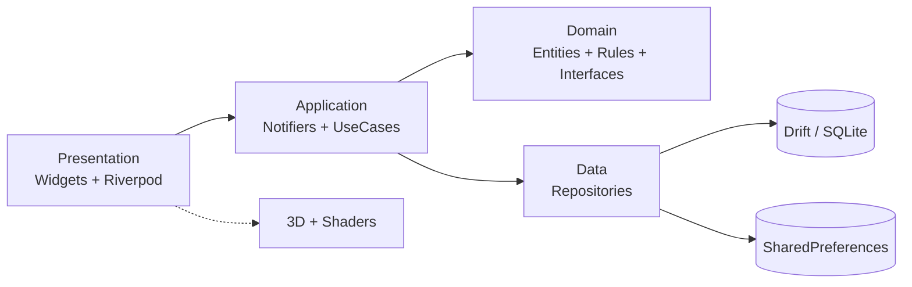

# myBMI — Reverse-Engineered Project Prompt & Redesign Specification

> **Document type:** Reverse-engineered build prompt + product/engineering specification
> **App:** myBMI (package `my_bmi`, Android id `com.example.bmi_calculator`)
> **Current version:** 1.1.0+2
> **Target version:** 2.0.0
> **Generated:** 2026-10-28
> **Toolchain baseline:** Flutter 3.47.7 · Dart 3.13.5 · Android API 36 · iOS 15+ · Impeller
> **Design baseline:** Google Material 3 **Expressive** (m3.material.io), expressive motion, 35-shape library, emphasized typography, dynamic color

---

## How to use this document

This file is a **prompt** first and a specification second. Hand it to a senior Flutter engineer (human or AI agent) and it should be possible to (a) recreate the shipped v1.1 app exactly, and (b) evolve it into the v2.0 vision without further product discovery.

Read it in this order:

1. **§1–§2** — the reverse-engineered prompt: what exists today, precisely.
2. **§3–§5** — the redesign: Material 3 Expressive, signature 3D/animation experiences, new features.
3. **§6–§9** — engineering: architecture, rendering, motion, testing.
4. **§10–§13 + appendices** — privacy, roadmap, acceptance criteria, formulas, and a condensed copy-paste prompt.

> **Prompt voice:** Where this document says “you”, it addresses the implementing engineer/agent. Everything is a requirement unless marked *optional* or *experimental*.

---

## Table of contents

- [1. Role & mission](#1-role--mission)
- [2. Reverse-engineered snapshot of v1.1](#2-reverse-engineered-snapshot-of-v11)
- [3. Product vision for v2.0](#3-product-vision-for-v20)
- [4. Material 3 Expressive design system](#4-material-3-expressive-design-system)
- [5. Signature experiences](#5-signature-experiences)
- [6. Technical architecture](#6-technical-architecture)
- [7. 3D & graphics implementation](#7-3d--graphics-implementation)
- [8. Motion choreography](#8-motion-choreography)
- [9. Testing, quality & CI/CD](#9-testing-quality--cicd)
- [10. Privacy, security & ethics](#10-privacy-security--ethics)
- [11. Analytics & experimentation](#11-analytics--experimentation)
- [12. Delivery roadmap](#12-delivery-roadmap)
- [13. Definition of done](#13-definition-of-done)
- [Appendix A — Formulas & reference ranges](#appendix-a--formulas--reference-ranges)
- [Appendix B — Copy-paste master prompt](#appendix-b--copy-paste-master-prompt)

---

## 1. Role & mission

**You are** a senior Flutter engineer and product designer with deep knowledge of:

- Material 3 / Material 3 Expressive design systems and accessibility
- Flutter rendering internals: Impeller, Flutter GPU, fragment shaders, raster/UI thread budgets
- Modern Dart architecture: clean architecture, Riverpod 3, go_router, sealed classes, code generation
- Local-first data, privacy-by-default, and medical/health UX ethics
- Motion design: spring physics, choreography, reduced-motion behavior

**Your mission:** rebuild myBMI as a **premium, offline-first, privacy-respecting health utility** that feels like a physical instrument — expressive, tactile, fast — while preserving every existing capability and adding the signature experiences in §5.

**Non-negotiables:**

1. The app works fully offline, with zero account and zero network permission required for core features.
2. All v1.1 functionality survives the redesign (see the parity checklist in §2.3).
3. Every screen is usable with screen readers, 200% text scaling, reduced motion, and one hand.
4. 60 fps minimum on mid-tier Android; 120 fps where the display allows.
5. No medical diagnosis claims; every health output is framed as an estimate/screening signal.

---

## 2. Reverse-engineered snapshot of v1.1

### 2.1 One-line pitch

> A dark, glassmorphic BMI and body-fat calculator for Android/iOS/web/desktop: four tabs, instant results with an animated gauge, a saved measurement history, reference tables, and ten languages — entirely local.

### 2.2 Current feature inventory

| Area | What exists today |
|---|---|
| Calculator | Gender toggle (male/female), metric/imperial switch, weight, height, age inputs, validation, BMI + Deurenberg body-fat estimate, category, animated arc gauge, save-to-history |
| Reference | WHO-style BMI category table (8 bands), body-fat percentage ranges by sex, formula explainer card |
| History | Reverse-chronological saved records, swipe-to-delete, clear-all confirmation, empty state |
| Settings | Name, default age, default gender, default height/weight, unit system, language (10 locales), save confirmation |
| Persistence | `SharedPreferences` storing JSON-encoded history and settings; loads on startup |
| Localization | `flutter gen-l10n` with ARB files; 10 locales incl. RTL Arabic |
| Design | “Liquid Glass”: deep-space background, animated blurred blobs, `BackdropFilter` glass cards, purple/cyan palette, Outfit font |
| Platforms | Android, iOS, web, Windows, macOS, Linux (Flutter multi-platform scaffold) |
| Branding | App name **myBMI**, custom 1024×1024 launcher icon, generated for all platforms via `flutter_launcher_icons` |

### 2.3 Screen-by-screen parity checklist

Use this as the regression contract. Every item must still work after the redesign.

#### Calculate (`CalculatorScreen`)

- [ ] Gender selector with Male / Female (localized)
- [ ] Unit switch: Imperial ↔ Metric, default from settings
- [ ] Weight field — kg (metric) or lbs (imperial), decimal comma accepted
- [ ] Height field — cm or inches, decimal comma accepted
- [ ] Age field — integer
- [ ] Validation ranges: height 50–250 cm, weight 10–500 kg, age 0–120
- [ ] Error snackbar on invalid/missing input (`pleaseFillAll` fallback)
- [ ] BMI = weight(kg) / height(m)²
- [ ] Body fat = Deurenberg formula (see Appendix A)
- [ ] Category from 8-band table (Severe Thinness → Obese Class III)
- [ ] Animated gauge (≈1.2 s ease-out-cubic; progress = BMI clamped to 0–50 / 50)
- [ ] Result card: BMI number, “BMI” label, category chip, body-fat row
- [ ] “Save result” persists to history and shows confirmation
- [ ] Inputs pre-populated from user settings

#### Reference (`ReferenceTableScreen`)

- [ ] BMI categories table with color-coded rows
- [ ] Body-fat ranges table (male/female: Essential, Athletes, Fitness, Average, Obese)
- [ ] “About the formulas” info card with BMI + Deurenberg formulas and a medical disclaimer

#### History (`HistoryScreen`)

- [ ] Loading state
- [ ] Empty state with icon, “No records yet”, “Calculate your BMI and save it!”
- [ ] Record row: circular BMI badge (category color), localized category chip, body-fat %, weight/height + units, age, gender initial, formatted date/time (`MMM d, yyyy – HH:mm`)
- [ ] Swipe end-to-start to delete
- [ ] Clear all with confirmation dialog
- [ ] Newest first

#### Settings (`SettingsScreen`)

- [ ] Profile card: name, default age, default gender chips
- [ ] Defaults card: language dropdown (System + 10 languages), unit segmented control, default height/weight
- [ ] Save settings with confirmation
- [ ] App version label
- [ ] Language change applies immediately (app-level locale)

#### Shell

- [ ] Four-tab bottom navigation: Calculate, Reference, History, Settings
- [ ] `IndexedStack` preserves tab state
- [ ] Glassmorphic floating nav bar over animated background

### 2.4 Domain rules (exact)

```
BMI              = weightKg / (heightCm / 100)²
Category         = <16 Severe Thinness | <17 Moderate Thinness | <18.5 Underweight
                   | <25 Normal | <30 Overweight | <35 Obese I | <40 Obese II | else Obese III
BodyFat (est.)   = max(0, 1.20 × BMI + 0.23 × age − 10.8 × sex − 5.4)
                   sex = 1 for male, 0 for female
lbs → kg         = lbs × 0.453592
inches → cm      = inches × 2.54
Validation        height 50–250 cm, weight 10–500 kg, age 0–120
```

Category colors (current): underweight `#42A5F5`, normal `#66BB6A`, overweight `#FFCA28`, obese `#EF5350`.

### 2.5 Data model (current)

**`BmiRecord`**

| Field | Type | Notes |
|---|---|---|
| `id` | String | epoch milliseconds |
| `weight` | double | stored in the unit the user entered |
| `height` | double | stored in the unit the user entered |
| `age` | int | |
| `gender` | String | `'male'` / `'female'` |
| `bmi` | double | computed at save time |
| `bodyFatPercentage` | double | computed at save time |
| `category` | String | English enum-like string |
| `dateTime` | DateTime | ISO-8601 in JSON |
| `isMetric` | bool | unit flag for display |

**`UserSettings`**: `name`, `defaultGender`, `defaultAge`, `useMetric`, `defaultHeight`, `defaultWeight`, `languageCode` (`'system'` or ISO code).

Persistence keys: `bmi_history`, `user_settings` (JSON strings in SharedPreferences).

### 2.6 Current architecture

```
lib/
├── main.dart                 # MultiProvider + MaterialApp + 4-tab shell
├── models/                   # BmiRecord, UserSettings (manual JSON)
├── screens/                  # calculator, history, reference_table, settings
├── services/                 # BmiService (pure), StorageService, providers
├── theme/                    # AppTheme, FluidBackground, GlassContainer
└── l10n/                     # ARB + generated localizations (10 locales)
```

- State: `provider` + `ChangeNotifier` (`SettingsProvider`, `HistoryProvider`)
- Persistence: `shared_preferences` + manual JSON
- Navigation: `IndexedStack` inside one `Scaffold`; no router
- Styling: static `AppTheme` colors + `google_fonts` runtime fetch
- Tests: one `widget_test.dart` with BmiService unit tests + two smoke tests
- Dependencies: `provider`, `shared_preferences`, `intl`, `google_fonts`, `flutter_localizations`, `cupertino_icons`

### 2.7 Current design language

| Token | Value |
|---|---|
| Background | `#07071F` (deep space) |
| Primary | `#6C63FF` |
| Accent | `#00E5FF` |
| Surface | `#131333` |
| Error / success | `#FF5252` / `#4CAF50` |
| Glass | white @ 10–33% + 15 px backdrop blur |
| Radius | 16–24 dp |
| Type | Outfit (300–800) |
| Motion | 10 s looping blob drift; 1.2 s gauge; 250 ms chips |

### 2.8 Localization

10 locales: `en, zh, es, ar, id, pt, fr, ja, ru, de`. ARB-driven; `appTitle`, nav labels, all form labels, formulas, dialogs, snackbars localized. RTL is supported by Flutter automatically but not explicitly tested today.

### 2.9 Known limitations / technical debt

1. `google_fonts` downloads Outfit at runtime → **fails offline** (observed on device: `Failed host lookup: fonts.gstatic.com`).
2. No router; deep links, predictive back, and state restoration are absent.
3. `SharedPreferences` JSON rewrites the entire history on every change; no migrations, no queries, no indexes.
4. No error types — validation returns display strings; storage swallows exceptions.
5. Minimal tests; no golden tests, no integration tests, no CI.
6. Single fixed dark theme; no light theme, no dynamic color, no contrast handling.
7. Design is a custom glass style, not Material 3 Expressive; components are hand-rolled.
8. No accessibility audit; symbols-only controls lack semantics labels in places.
9. History is display-only — no charts, trends, goals, or insights.
10. Tab shell uses `IndexedStack`; no transition choreography, no adaptive layout, no tablet/foldable layout.

---

## 3. Product vision for v2.0

### 3.1 Design principles

1. **Instrument, not dashboard.** The BMI readout should feel like a precision dial on a physical device — weighty, responsive, alive.
2. **Calm by default, expressive on intent.** Idle surfaces are quiet; motion blooms only in response to user action or meaningful data change.
3. **One thumb, one glance.** Primary actions live in the bottom third; the result is legible from 30 cm.
4. **Honest data.** Always show units, ranges, formula provenance, and uncertainty. Never imply diagnosis.
5. **Private by construction.** Local-first storage, no account, no telemetry without explicit opt-in.
6. **Beautiful on every tier.** 3D on capable devices, equally intentional 2.5D everywhere else.

### 3.2 Jobs to be done

| Job | Today | v2.0 outcome |
|---|---|---|
| “What is my BMI right now?” | Form → number | Live, tactile dial that updates as you type |
| “Is this healthy?” | Color chip | Body Atlas + range position + plain-language insight |
| “Am I improving?” | Flat list | Animated trend story, goal projection, streaks |
| “What if I lose 5 kg?” | Impossible | What-if simulator with live 3D morph + projection |
| “Keep my data private” | Local JSON | Encrypted local DB, biometric lock, export/erase |
| “Use it in my language” | 10 locales | 10 locales + RTL polish + ICU plurals |

### 3.3 Success metrics (local, privacy-safe)

- Time-to-result < 4 s from cold start (cached inputs).
- 90% of sessions reach a result without an error.
- 7-day retention ≥ 25% (opt-in aggregate only, or measured via local counters the user can inspect).
- Crash-free sessions ≥ 99.5%.
- 60 fps p95 on a 2021 mid-tier Android device; 120 fps on flagship.
- Accessibility: zero critical issues in TalkBack/VoiceOver audit; contrast ≥ 4.5:1.

### 3.4 Feature map

| Keep | Improve | Add |
|---|---|---|
| 4-tab structure | M3E navigation bar with spring indicator | 3D Body Atlas |
| BMI + Deurenberg BF | Multiple BF methods + method picker | Vital Orb gauge |
| History list | Trend charts, goals, streaks | What-if simulator |
| Reference tables | Interactive range explorer | Insight engine |
| 10 locales | RTL polish + plurals + pseudo-locale | Share cards / PDF / CSV |
| Glass aesthetic | Evolve into “Expressive Glass” | Home widget, Health Connect/HealthKit, biometric lock |
| Settings | Onboarding + profile | AI coach (optional, on-device) |

---

## 4. Material 3 Expressive design system

> **Reality check (2026):** Flutter froze the bundled Material library in 3.44 and shipped standalone `material_ui` 1.0 in 3.47. M3 Expressive components are still landing upstream (tracking issue `flutter/flutter#168813`). Adopt `material_ui` (with `MaterialUiCompatibilityBridge` while plugins catch up) and use the community `material_3_expressive` package or custom widgets for components Flutter has not shipped yet. Do **not** block the redesign on upstream parity.

### 4.1 Color

- Generate the scheme with `ColorScheme.fromSeed(seedColor: brandSeed, dynamicSchemeVariant: DynamicSchemeVariant.fidelity)`.
- **Brand seed:** evolve `#6C63FF` (electric indigo) into an expressive triad:
  - Primary: indigo-violet
  - Secondary: mint-teal
  - Tertiary: warm apricot
  - Error: coral red
- **Dynamic color:** opt-in “Match my wallpaper” (Android 12+) using `dynamic_color`; fall back to brand scheme.
- **Tonal surfaces:** use `surfaceContainerLowest … Highest` instead of hard-coded hex values. Glass effects are an *accent*, not the base surface.
- **Contrast:** never encode category by hue alone; pair color with icon, label, and position.
- **Category palette (v2, color-blind-aware):** underweight azure, normal jade, overweight amber, obese vermilion — each with a distinct icon (`south`, `check_circle`, `north`, `warning`).

### 4.2 Typography

- Bundle **Roboto Flex** (variable) as the primary face; use **Noto Sans** fallback for CJK/Arabic scripts.
- Expressive type scale: display/headline styles at weight 700–800 with tight tracking; body at 400–500; labels at 600.
- Numeric readouts use **tabular figures** (`FontFeature.tabularFigures()`) so the dial digits do not jitter.
- Support text scaling to 200% without clipping; use `MediaQuery.textScalerOf`.

### 4.3 Shape

- Use the **35-shape M3 Expressive library** (cookie, gem, sunny, burst, flower, pill, arch, slanted, diamond, clover, etc.).
- Define app shape tokens: `extraSmall 8`, `small 12`, `medium 16`, `large 24`, `extraLarge 32`, plus expressive morph targets.
- **Shape morphing** on state change: pill → cookie on save; circle → burst on goal completion. Implement with `ShapeBorder` interpolation or `RoundedPolygon` (from `material_shapes`/`material_3_expressive`).
- Cards use 24–28 dp radii; buttons full pill; FAB uses a 16-shape morph.

### 4.4 Motion

- Adopt the M3 Expressive **motion physics** model:
  - **Spatial** motion for position/size changes: springy, overshoot allowed (damping ≈ 0.8–0.9).
  - **Effects** motion for color/opacity: fast, no overshoot (damping ≈ 1.0).
- Token table (see §8) with durations 100/200/300/450/600 ms and spring descriptions.
- Use `MotionScheme.expressive()` where available; otherwise implement a `AppMotion` token layer over `SpringDescription` + `AnimationController.animateWith(SpringSimulation(...))`.
- All motion respects `MediaQuery.disableAnimations` and platform “remove animations”.

### 4.5 Elevation & surfaces

- Replace glass-everything with **tonal elevation**: filled cards, subtle outlines, and selective translucency only on the floating nav, sheets, and the Vital Orb stage.
- Keep one signature glass surface (nav bar) to preserve brand continuity; use `BackdropFilter` sparingly (it is expensive).
- Shadows: M3 elevation tints, not pure black.

### 4.6 Component mapping

| v1.1 element | v2.0 M3E component |
|---|---|
| Bottom nav | `NavigationBar` with springy indicator + labels |
| Gender toggle | `SegmentedButton` (or expressive `ButtonGroup`) |
| Unit switch | `SegmentedButton` |
| Text fields | `TextField` with `ShapedInputBorder` + supporting text |
| Calculate CTA | `FilledButton` (large, 56 dp) with press-scale + haptic |
| Result card | Expressive card with 3D stage + `CarouselView` of metrics |
| Category chip | `AssistChip` / tonal badge with icon |
| Save action | `FilledButton.tonalIcon` |
| History row | `ListTile` inside expressive card + `Dismissible` |
| Clear all | `AlertDialog` (M3) |
| Settings sections | `ExpansionTile` / cards with `SwitchListTile` |
| Language picker | `MenuAnchor` / modal bottom sheet with search |
| Snackbars | M3 `SnackBar` with action |
| FAB (new) | Large expressive FAB → “Quick add” |
| Loading | M3 Expressive loading indicator (morphing shapes) |

### 4.7 Layout & adaptive breakpoints

| Width | Layout |
|---|---|
| < 600 dp | Single column, bottom nav, result sheet |
| 600–839 dp | Two-pane: inputs left, result/3D right; navigation rail |
| ≥ 840 dp | Three-pane: nav rail + form + insights; max content width 1200 dp |
| Foldables | Respect hinge via `MediaQuery.displayFeatures`; avoid splitting the 3D stage |
| Landscape phones | Inputs and result side-by-side, scrollable form |

Use `flutter_adaptive_scaffold` (or hand-rolled `LayoutBuilder` + `NavigationRail`) and test at 320/600/840/1280 dp.

### 4.8 Edge-to-edge & platform chrome

- Android 15/16 enforce edge-to-edge; adopt `SystemUiMode.edgeToEdge`, transparent system bars, and `SafeArea`.
- Use `MediaQuery.displayCornerRadii` (Flutter 3.44+) to avoid clipping on rounded displays.
- Predictive back: `android:enableOnBackInvokedCallback="true"` + go_router-aware handling.
- Status bar icons adapt to light/dark surfaces.

### 4.9 Accessibility

- WCAG 2.2 AA: contrast ≥ 4.5:1 (text), ≥ 3:1 (large text/graphics).
- 48×48 dp minimum targets; 8 dp spacing.
- Semantic labels for every icon-only control; live-region announcements for BMI result changes.
- Focus order matches visual order; visible focus rings for keyboard/switch access.
- Support `MediaQuery.highContrast`, `invertColors`, and bold text (Flutter 3.47 exposes Android high-contrast/inversion).
- Never rely on color alone; include text + icon + shape.
- Test with TalkBack, VoiceOver, 200% text, and reduced motion.

---

## 5. Signature experiences

These are the “surprise” features. Each has a defined fallback so no device is left behind.

### 5.1 Body Atlas — interactive 3D body stage

**What:** A stylized, low-poly human mannequin rendered in real time. It slowly orbits at rest; drag to rotate; pinch to zoom. The silhouette morphs between three authored body shapes (slim / balanced / full) driven continuously by BMI, with the current category highlighted as a glowing contour line. Tapping a body region reveals a tooltip (“BMI is a whole-body screening index; it does not measure muscle or fat distribution”).

**Why it wins:** It turns an abstract number into a spatial, memorable object — and it is the app’s visual identity.

**Implementation:**

- Renderer: `flutter_scene` (Flutter GPU; Impeller on native, WebGL2 on web). GLB/GLTF asset, ~8–12k triangles, 3 morph targets, PBR + rim light, one 1k HDR for image-based lighting.
- Morph weights: `slim = clamp((25 − bmi)/10, 0, 1)`, `full = clamp((bmi − 25)/10, 0, 1)`, `balanced = 1 − abs(bmi − 22)/10` normalized.
- Camera: 35° FOV, orbit damping with spring; idle auto-rotation at 4°/s; pause when off-screen or reduced motion.
- Category contour: a second material pass with Fresnel + emissive color; intensity pulses on result change.
- Fallback tier: Rive state machine with three vector silhouettes and blend; tier 2: `CustomPainter` silhouette with gradient stroke.
- Budget: ≤ 3 ms GPU/frame on mid-tier; drop IBL and shadows first, then triangles.

### 5.2 Vital Orb — the BMI dial, reimagined

**What:** Replace the flat arc gauge with a liquid-metal orb that fills and shifts color as BMI changes. Idle: slow metaball breathing. On calculate: a spring-driven “surge” that settles at the exact BMI rotation; digits count up with tabular figures.

**Implementation:**

- Fragment shader (`shaders/vital_orb.frag`) raymarching a signed-distance metaball with 2–3 blended spheres; uniforms: `uTime`, `uFill`, `uCategoryColor`, `uPress`, `uResolution`.
- Use Flutter 3.44+ named uniforms: `shader.getUniformFloat('uFill').set(value)`.
- Render inside a `CustomPaint`/`ShaderMask` at device pixel ratio, capped at 1.5× for battery.
- Fallback: `CustomPainter` arc + radial gradients (the v1.1 gauge, upgraded).
- Reduced motion: static orb at target fill; no idle breathing.

### 5.3 Particle Bloom — meaningful celebration

**What:** When a measurement lands in the healthy range, completes a streak, or hits a goal, a short (~900 ms) bloom of GPU-instanced particles erupts from the orb, then dissolves. Not confetti spam: the particle count and palette derive from the category and streak length.

**Implementation:**

- `CustomPainter` + `Canvas.drawRawPoints` or a fragment shader; 300–600 particles max; additive blending; pooled objects; no per-frame allocations.
- Haptics: `HapticFeedback.lightImpact` at burst, `selectionClick` on settle.
- Disabled entirely under reduced motion; replaced by a 200 ms scale/glow.

### 5.4 Health Rings & trend story

**What:** Three concentric rings (BMI position, body-fat estimate, measurement consistency) with spring sweep and gradient stroke. History becomes a scrollable “story”: weekly cards with a sparkline, delta chips (“−0.8 BMI this month”), and a projected goal date.

**Implementation:**

- Rings: `CustomPainter` with `SweepGradient`, `StrokeCap.round`, animation via `AnimationController` + `CurvedAnimation`.
- Charts: `fl_chart` for standard line/bar charts; custom painter for the signature sparkline.
- “Story” cards: `PageView` with `CarouselView` semantics; each card is golden-tested.
- Statistics: 7/30/90-day windows, linear regression slope (BMI velocity), moving average, min/max, adherence.

### 5.5 What-if simulator

**What:** A dedicated “What if?” mode with draggable weight/height/age controls. The Vital Orb and Body Atlas update live; a projection card shows “At 78 kg your BMI would be 24.2 (Normal)” and a safe-rate goal timeline.

**Implementation:**

- Debounced (16–32 ms) recomputation of pure domain functions; no persistence until “Save as goal”.
- Sliders use haptic detents every 1 kg / 1 cm; value bubble follows the thumb.
- Projection: energy-balance approximation (7,700 kcal ≈ 1 kg), capped at 0.25–1.0 kg/week; show a range, not a promise.

### 5.6 Insight engine (on-device, explainable)

**What:** Plain-language, rule-based insights: “Your BMI is in the healthy range, but your body-fat estimate is above average for your age — strength training may be more informative than weight loss.” Every insight lists its inputs and the rule that fired.

**Implementation:**

- Pure Dart rule engine (`InsightRule` with `when(input)`, `priority`, `messageKey`), fully unit-tested.
- No LLM required. Optional “Ask myBMI” coach uses on-device Gemma 4 via `flutter_gemma` (if the device supports it), with a strict system prompt, no network, and a visible “on-device” badge.
- Guardrails: no diagnosis, no calorie prescription, no eating-disorder encouragement; crisis resources when extreme inputs are detected.

### 5.7 Share cards, export & reports

- **Share card:** `RepaintBoundary.toImage` renders a 1080×1350 branded card (gradient, BMI, category, sparkline, QR-free). Share via `share_plus`.
- **PDF report:** `pdf` + `printing`; includes measurements, charts, reference ranges, formula provenance, and a disclaimer.
- **CSV export/import:** `csv` + `file_picker`; round-trips history with schema version.
- **Privacy:** exports are user-initiated, written to a temp dir, and cleaned up after share.

### 5.8 Platform integrations (*optional, opt-in*)

- **Home widget:** `home_widget` — last BMI + category + “Quick add” deep link.
- **Health Connect / HealthKit:** `health` — import weight; optionally write weight. Never write BMI (not a standard health record).
- **Biometric lock:** `local_auth`; blur the app switcher snapshot via `FLAG_SECURE` (Android) and an overlay (iOS).
- **Voice entry:** `speech_to_text` parsing “seventy kilos, one seventy-five”; graceful fallback to keyboard.
- **Wear OS companion** (stretch): read-only last result + quick log.

### 5.9 Experimental (flagged, off by default)

- **AR quick look:** place the Body Atlas mannequin in the room via `ar_flutter_plugin`/ARKit; gated, with a clear “experimental” label.
- **GenUI coach:** A2UI/genui-generated insight cards; still local-first and rule-constrained.
- **Foldable posture:** hinge-aware split view for the simulator.

---

## 6. Technical architecture

### 6.1 Stack decisions

| Concern | Choice | Rationale |
|---|---|---|
| SDK | Flutter 3.47.7 / Dart 3.13.5 | Impeller everywhere; Flutter GPU; M3 |
| UI library | `material_ui` 1.0 (opt-in) + `material_3_expressive` where needed | Decoupled design system, weekly fixes |
| State | Riverpod 3 (`flutter_riverpod`, `riverpod_annotation`, `riverpod_generator`) | Compile-safe DI, async state, testability |
| Routing | `go_router` + typed routes | Deep links, predictive back, restoration |
| Models | `freezed` 3 + `json_serializable` | Immutability, unions, codegen |
| Database | `drift` (SQLite) + `drift_flutter` | Queries, migrations, indexes, reactive streams |
| Preferences | `shared_preferences` (only lightweight flags) | Keep the simple stuff simple |
| 3D | `flutter_scene` + `vector_math` + `flutter_scene_importer` | Flutter GPU-native 3D |
| Vector motion | `rive` | Interactive state machines, tiny assets |
| Charts | `fl_chart` + custom painters | Standard charts + signature visuals |
| Fonts | Bundled Roboto Flex + Noto Sans (no runtime fetch) | Offline correctness |
| L10n | `flutter gen-l10n` + ARB, 10 locales | Existing investment |
| Testing | `flutter_test`, `mocktail`, `golden_toolkit`, `patrol`, `integration_test` | Full pyramid |
| Lint | `very_good_analysis` + `custom_lint` + `riverpod_lint` | Strict, consistent |
| CI | GitHub Actions | Analyze, test, golden, build |

> Confirm current package majors on pub.dev before pinning; this table states intent, not lockfile versions.

### 6.2 Folder structure (feature-first clean architecture)

```
lib/
├── main.dart
├── bootstrap.dart                 # runZonedGuarded, error handlers, DI overrides
├── app/
│   ├── app.dart                   # MaterialApp.router, theme, locale
│   ├── router.dart                # GoRouter + typed routes
│   └── shell/                     # adaptive scaffold, nav rail/bar
├── core/
│   ├── domain/                    # Result, Failure, Clock, UnitSystem
│   ├── design/                    # tokens, theme, shapes, motion, typography
│   ├── widgets/                   # GlassSurface, VitalOrb, SectionCard, ...
│   ├── l10n/                      # ARB + generated
│   ├── utils/                     # parsers, formatters, debouncer
│   └── telemetry/                 # no-op by default, opt-in
├── features/
│   ├── calculator/
│   │   ├── domain/                # BmiCalculator, BodyFatCalculator, entities
│   │   ├── data/                  # repositories (history, settings)
│   │   ├── application/           # Riverpod notifiers/providers
│   │   └── presentation/          # screen, widgets, 3D stage
│   ├── history/
│   ├── reference/
│   ├── settings/
│   ├── insights/
│   ├── simulator/
│   ├── share/
│   └── onboarding/
├── 3d/
│   ├── scene/                     # flutter_scene setup, camera, materials
│   ├── shaders/                   # *.frag, *.glsl
│   └── assets/                    # glb, hdr, textures (imported)
└── l10n/                          # app_*.arb
assets/
├── fonts/                         # RobotoFlex, NotoSans*
├── images/
├── rive/
└── data/                          # reference ranges (JSON, versioned)
```

**Dependency rule:** `presentation → application → domain ← data`. Domain has no Flutter imports. Data implements domain repositories. No feature imports another feature’s presentation layer; shared UI lives in `core/widgets`.

### 6.3 Layer contracts

```dart
// domain
abstract interface class HistoryRepository {
  Stream<List<BmiRecord>> watchAll();
  Future<Result<void>> add(BmiRecord record);
  Future<Result<void>> delete(String id);
  Future<Result<void>> clear();
}

// application
@riverpod
class HistoryController extends _$HistoryController {
  @override
  Stream<List<BmiRecord>> build() => ref.watch(historyRepositoryProvider).watchAll();
}
```



### 6.4 Result & error handling

```dart
sealed class Result<T> {
  const Result();
  bool get isOk => this is Ok<T>;
  T? get valueOrNull => switch (this) { Ok(:final value) => value, Err() => null };
}
final class Ok<T> extends Result<T> { final T value; const Ok(this.value); }
final class Err<T> extends Result<T> { final Failure failure; const Err(this.failure); }

sealed class Failure {
  const Failure(this.message);
  final String message;
}
final class ValidationFailure extends Failure { const ValidationFailure(super.message); }
final class StorageFailure extends Failure { const StorageFailure(super.message, {this.cause}); final Object? cause; }
final class NotFoundFailure extends Failure { const NotFoundFailure(super.message); }
```

- Domain functions return `Result` (never throw for expected failures).
- UI maps `Failure` to localized messages; no raw exception strings shown.
- `runZonedGuarded` + `FlutterError.onError` + `PlatformDispatcher.instance.onError` funnel unexpected errors to a redacted log; opt-in crash reporting only.

### 6.5 Persistence (drift)

```sql
CREATE TABLE bmi_records (
  id TEXT PRIMARY KEY,
  measured_at INTEGER NOT NULL,
  weight_kg REAL NOT NULL,      -- canonical storage: always kg/cm
  height_cm REAL NOT NULL,
  age INTEGER NOT NULL,
  gender TEXT NOT NULL,
  bmi REAL NOT NULL,
  body_fat REAL NOT NULL,
  category TEXT NOT NULL,
  source TEXT NOT NULL DEFAULT 'manual',
  note TEXT
);
CREATE INDEX idx_records_measured_at ON bmi_records(measured_at DESC);

CREATE TABLE goals (
  id TEXT PRIMARY KEY,
  target_bmi REAL,
  target_weight_kg REAL,
  target_date INTEGER,
  created_at INTEGER NOT NULL
);

CREATE TABLE settings (
  key TEXT PRIMARY KEY,
  value TEXT NOT NULL
);
```

- Store canonical metric units; convert at the edges. This fixes the v1.1 “stored in entered unit” ambiguity.
- Schema versioning via drift migrations; write a migration test for every version.
- Reactive queries power history and insights; no full-list rewrites.
- Encrypted option: SQLCipher (`sqlcipher_flutter_libs`) behind a biometric-derived key (phase 4).

### 6.6 Routing

```dart
final router = GoRouter(
  routes: [
    StatefulShellRoute.indexedStack(
      builder: (context, state, shell) => AdaptiveShell(shell: shell),
      branches: [
        StatefulShellBranch(routes: [GoRoute(path: '/calculate', builder: ...)]),
        StatefulShellBranch(routes: [GoRoute(path: '/reference', builder: ...)]),
        StatefulShellBranch(routes: [GoRoute(path: '/history', builder: ...)]),
        StatefulShellBranch(routes: [GoRoute(path: '/settings', builder: ...)]),
      ],
    ),
    GoRoute(path: '/simulator', parentNavigatorKey: rootKey, ...),
    GoRoute(path: '/record/:id', ...),
    GoRoute(path: '/share', ...),
  ],
);
```

- Deep link `mybmi://record/<id>` and `<base>/record/<id>` on web.
- Predictive back: let go_router pop; never intercept without a visible affordance.
- `restorationScopeId` + `RestorableRoute` where possible.

### 6.7 Offline fonts & localization

- Add `assets/fonts/RobotoFlex-VariableFont.ttf`, `NotoSans-*.ttf`; declare `fonts:` in `pubspec.yaml`.
- Remove runtime dependency: `GoogleFonts.config.allowRuntimeFetching = false` (or drop `google_fonts` entirely and use bundled families).
- Keep 10 ARB locales; add ICU plurals (`{count, plural, ...}`), select for gender, and a `ps` pseudo-locale for QA.
- Use `GlobalMaterialLocalizations.delegates` if migrating to `material_ui`.
- Verify RTL mirroring for the nav, charts, and 3D HUD.

### 6.8 Code standards

- `dart format` in CI; `very_good_analysis` at error level.
- Prefer `const`, `final`, exhaustive `switch`, sealed unions.
- One public class per file; file names `snake_case`.
- No business logic in widgets; no `BuildContext` in domain/data.
- All user-facing strings localized (no literals).
- All colors/typography/spacing from tokens (no magic numbers).
- Document public APIs with `///`; explain *why*, not *what*.
- Feature flags in one place (`AppFlags`), default safe.

---

## 7. 3D & graphics implementation

### 7.1 Rendering tiers

Detect once at startup and cache:

| Tier | Criteria | Experience |
|---|---|---|
| **High** | Vulkan/Metal + ≥ 4 GB RAM + not low-power mode | Full 3D Body Atlas, IBL, shadows, Vital Orb shader, Particle Bloom |
| **Medium** | Impeller OpenGLES / older GPU | Simplified 3D (no IBL/shadows), orb shader, fewer particles |
| **Low** | Web without WebGL2, reduced motion, battery saver | Rive/CustomPainter silhouette, static orb, no particles |

```dart
enum RenderTier { high, medium, low }

RenderTier detectRenderTier() {
  if (kIsWeb) return RenderTier.medium; // flutter_scene WebGL2 backend
  if (Platform.isAndroid || Platform.isIOS) {
    // Probe: attempt to create the Flutter GPU context once, catch failures;
    // also consider MediaQuery.boldText / accessibleNavigation / battery saver.
    return RenderTier.high;
  }
  return RenderTier.high;
}
```

> Never assume; gate on capability probes and a user-facing “Reduce graphics” setting.

### 7.2 flutter_scene skeleton

```dart
// pubspec: flutter_scene, vector_math, flutter_scene_importer (dev)
final scene = Scene();
final camera = PerspectiveCamera()
  ..fovY = 35 * (math.pi / 180)
  ..position = Vector3(0, 1.1, 3.2);
final mannequin = await scene.loadGlb('assets/3d/mannequin.glb');

class BodyAtlas extends StatefulWidget { ... }

// Per-frame:
void update(double bmi) {
  final slim = ((25 - bmi) / 10).clamp(0.0, 1.0);
  final full = ((bmi - 25) / 10).clamp(0.0, 1.0);
  mannequin.setMorphWeights(slim: slim, balanced: 1 - slim - full, full: full);
  camera.orbit(delta: _dragDelta, spring: AppMotion.spatial);
}
```

- Import GLB at build time with `flutter_scene_importer` (native assets experiment); commit the generated `.model` to VCS to keep builds hermetic.
- Enable Flutter GPU per platform as documented by `flutter_scene`; Impeller is already default on native in 3.47.
- Render the 3D view inside a `SizedBox` with a `RepaintBoundary`; pause the ticker when not visible.
- Dispose scene resources deterministically; assert no GPU resource leaks in debug.

### 7.3 Fragment shaders

Files:

| Shader | Purpose | Uniforms |
|---|---|---|
| `vital_orb.frag` | Metaball orb + fill + category tint | `uTime`, `uFill`, `uColor`, `uPress`, `uResolution` |
| `particle_bloom.frag` | Additive particle burst | `uTime`, `uSeed`, `uCount`, `uColorA/B` |
| `aurora.frag` | Low-cost expressive background | `uTime`, `uSeed`, `uTint` |
| `glass_refraction.frag` | Signature nav refraction (optional) | `uBlur`, `uTint` |

```glsl
// vital_orb.frag (sketch)
#version 460 core
#include <flutter/runtime_effect.glsl>

uniform float uTime;
uniform float uFill;
uniform vec4 uColor;
uniform vec2 uResolution;
out vec4 fragColor;

float smin(float a, float b, float k) {
  final float h = clamp(0.5 + 0.5 * (b - a) / k, 0.0, 1.0);
  return mix(b, a, h) - k * h * (1.0 - h);
}

float map(vec3 p) {
  float t = uTime * 0.6;
  float a = length(p - vec3(sin(t) * 0.18, cos(t * 0.8) * 0.12, 0.0)) - 0.55;
  float b = length(p - vec3(cos(t * 1.1) * 0.22, -0.1, 0.1)) - 0.38;
  return smin(a, b, 0.35);
}

void main() {
  vec2 uv = (FlutterFragCoord().xy * 2.0 - uResolution) / min(uResolution.x, uResolution.y);
  vec3 ro = vec3(0.0, 0.0, 2.2);
  vec3 rd = normalize(vec3(uv, -1.8));
  float d = 0.0;
  for (int i = 0; i < 64; i++) {
    vec3 p = ro + rd * d;
    float h = map(p);
    if (h < 0.001) break;
    d += h * 0.75;
  }
  vec3 n = normalize(vec3(map(ro + rd * d + vec3(0.001, 0, 0)) - map(ro + rd * d),
                          map(ro + rd * d + vec3(0, 0.001, 0)) - map(ro + rd * d),
                          map(ro + rd * d + vec3(0, 0, 0.001)) - map(ro + rd * d)));
  float fres = pow(1.0 - max(dot(n, -rd), 0.0), 3.0);
  vec3 col = mix(uColor.rgb, vec3(1.0), fres * 0.6) * (0.6 + 0.4 * max(dot(n, vec3(0.4, 0.8, 0.5)), 0.0));
  fragColor = vec4(col, smoothstep(0.0, 0.02, d));
}
```

- Use `FragmentProgram.fromAsset('shaders/vital_orb.frag')` and the named-uniform API.
- Cap raymarch steps by tier (64 high / 40 medium / none low).
- Pre-warm shaders on first frame with an offscreen 1×1 draw to avoid first-use jank.

### 7.4 Vector & 2D assets

- **Rive** for the mannequin fallback, success morphs, and the empty-state illustration. State machine inputs: `bmi`, `category`, `reducedMotion`.
- **SVG** (`flutter_svg`) for icons/illustrations; prefer vector over PNG.
- **Lottie** only if an asset cannot be authored in Rive; bundle JSON, never fetch remotely.
- **Iconography:** Material Symbols Rounded, variable weight/fill; avoid mixing icon families.

### 7.5 Asset budgets

| Asset | Budget |
|---|---|
| GLB mannequin | ≤ 2 MB, ≤ 12k tris, ≤ 3 morph targets |
| HDR | ≤ 1 MB (1k, RGBE) |
| Rive files | ≤ 150 KB each |
| Shaders | ≤ 8 KB each |
| Total app download | ≤ 25 MB Android AAB (base) |

Use `flutter build appbundle --analyze-size` and `--split-debug-info`; track size in CI.

### 7.6 Performance guardrails

- Frame budget: 8.3 ms at 120 Hz, 16.6 ms at 60 Hz.
- No allocations in `paint()`/tick callbacks; pool particles and paints.
- `RepaintBoundary` around the 3D stage and animated backgrounds; never around frequently changing text.
- Pause tickers when the route is not current or the app is backgrounded.
- Prefer `FadeTransition`/`SlideTransition` over rebuilding trees; use `AnimatedBuilder` narrowly.
- Profile on a real mid-tier device (`flutter run --profile`), capture a timeline, and fix jank before adding effects.
- Battery: cap background animation at 30 fps; stop the fluid background after 10 s of inactivity; honor battery saver.

---

## 8. Motion choreography

### 8.1 Tokens

| Token | Duration | Curve / spring | Use |
|---|---|---|---|
| `effectsFast` | 100 ms | linear/ease-out | color, opacity |
| `effectsBase` | 200 ms | ease-out | chips, switches |
| `spatialFast` | 200 ms | spring(damping 0.85) | small position shifts |
| `spatialBase` | 300 ms | spring(damping 0.82) | cards, sheets |
| `spatialSlow` | 450 ms | spring(damping 0.8, mass 1.1) | page/hero |
| `celebration` | 600–900 ms | spring + decay | orb surge, particles |
| `idle` | 6–10 s loop | sinusoidal | background/orb breathing |

### 8.2 Page & tab transitions

- Tab switch: fade-through + 8 dp upward slide + spring indicator; 250 ms; keep state via `StatefulShellRoute`.
- Result reveal: orb scales 0.94 → 1.0 with spring; digits count up 450 ms; category chip morphs shape at 300 ms.
- Detail push: shared-axis (X) transition on Android; iOS parallax; web fade.
- Sheets: M3 bottom sheet with drag-to-dismiss and scroll coordination.
- Dialogs: scale+fade 200 ms; scrim fades 150 ms.

### 8.3 Micro-interactions

| Interaction | Response |
|---|---|
| Press Calculate | scale 0.97, haptic `mediumImpact`, 120 ms |
| Unit switch | thumb spring + haptic `selectionClick`; fields cross-fade units |
| Gender change | selected chip morphs shape + color spring |
| Invalid field | shake 3×, 6 dp amplitude, 240 ms; error text + icon |
| Save success | orb pulse + particle bloom + snackbar action “View” |
| Swipe delete | row collapses with spring; undo snackbar 5 s |
| Goal reached | shape morph + bloom + share prompt |
| Pull to refresh (history) | M3 loading indicator morph |

### 8.4 Reduced motion

- `MediaQuery.disableAnimations == true` → durations 0–80 ms, no particles, no auto-orbit, no idle breathing, no parallax.
- Provide an in-app “Reduce motion” switch that overrides the platform.
- Never gate essential state changes on animation completion.

---

## 9. Testing, quality & CI/CD

### 9.1 Test pyramid

| Layer | Coverage target | Tools |
|---|---|---|
| Domain unit | 100% of formulas, parsers, rules | `flutter_test`, `mocktail` |
| Data | repository contracts, migrations | `drift` in-memory, `mocktail` |
| Application | notifiers, async states | `ProviderContainer` overrides |
| Widget | every screen + critical states | `flutter_test` |
| Golden | design system + signature cards | `golden_toolkit` |
| Integration | calculate → save → history → export | `integration_test`, `patrol` |
| Accessibility | tap targets, contrast, semantics | `meetsGuideline`, manual audit |
| Performance | startup, jank, memory | DevTools timeline, `flutter drive` |

### 9.2 Must-have tests

- BMI boundaries: 15.99/16/16.99/17/18.49/18.5/24.99/25/29.99/30/34.99/35/39.99/40.
- Unit conversion round-trips within 1e-9.
- Comma/dot parsing, whitespace, null, overflow, negative.
- Deurenberg: male/female/age 0/negative clamp.
- History ordering, deletion by id, clear, empty state.
- Settings persistence + locale change + RTL.
- Golden: light/dark, 320/600/840 dp, 100%/200% text, reduced motion.
- 3D fallback path renders when the tier is low.

### 9.3 CI pipeline

```yaml
name: ci
on: [push, pull_request]
jobs:
  quality:
    runs-on: ubuntu-latest
    steps:
      - uses: actions/checkout@v4
      - uses: subosito/flutter-action@v2
        with: { channel: stable, cache: true }
      - run: flutter pub get
      - run: dart format --output=none --set-exit-if-changed .
      - run: flutter analyze --fatal-infos
      - run: flutter test --coverage
      - run: flutter test --update-goldens # separate job on failure for review
  build:
    needs: quality
    runs-on: ubuntu-latest
    steps:
      - uses: actions/checkout@v4
      - uses: subosito/flutter-action@v2
      - run: flutter pub get
      - run: flutter build appbundle --release --obfuscate --split-debug-info=build/symbols
      - uses: actions/upload-artifact@v4
        with: { name: appbundle, path: build/app/outputs/bundle/release/ }
```

- Branch protection: analyze + tests + goldens required.
- Nightly: performance smoke on a physical device farm; size report.
- Release: signed AAB/IPA, changelog, store metadata, screenshots generated from golden fixtures.

---

## 10. Privacy, security & ethics

- **Local-first:** no account, no cloud sync by default, no analytics SDK unless the user opts in.
- **Data minimization:** only measurements and preferences; no contacts, location, or identifiers.
- **Encryption:** SQLCipher option; biometric gate; `FLAG_SECURE` on Android; app-switcher blur on iOS.
- **Export/erase:** one-tap delete all; export before delete; document what leaves the device.
- **Logging:** redact values; never log weight/height/age together with an identifier.
- **Permissions:** request only when a feature is used (health, mic, notifications); explain why before the system prompt.
- **Medical ethics:** BMI is a screening tool; body-fat is an estimate. Show provenance and limitations. Detect extreme inputs and surface support resources rather than “ideal weight” advice. No ads, no weight-loss guarantees, no gamified starvation.
- **Children/pregnancy/athletes:** explicit caveats; disable goal projections for minors (<18) and flag pregnancy.

---

## 11. Analytics & experimentation

- Default: a local-only event ring buffer the user can inspect and clear (“My data” screen).
- Opt-in aggregate analytics (e.g., feature usage counts) with a documented schema, no health values.
- A/B tests only for non-health UI copy/layout; never experiment with health thresholds.
- Feature flags: `bodyAtlas3d`, `vitalOrbShader`, `aiCoach`, `healthSync`, `arPreview`, each with kill switches.

---

## 12. Delivery roadmap

### Phase 0 — Foundations (1 week)

- Adopt `material_ui` (or keep core Material behind an abstraction if plugin compatibility requires it).
- Add `very_good_analysis`, `riverpod_lint`, `custom_lint`; format + analyze clean.
- Introduce `go_router`, `AppTheme` tokens, `Result`/`Failure`, bootstrap error handling.
- Bundle fonts; remove runtime font fetching; add offline test.
- CI pipeline green with existing tests.

**Exit:** app builds on all platforms; fonts render offline; analyze/format/tests pass.

### Phase 1 — M3E design system + calculator (2 weeks)

- Color/typography/shape/motion tokens; light + dark + dynamic color.
- Rebuild shell (adaptive nav), calculator form, result card, reference, settings.
- Add goldens at 3 widths × 2 themes × 2 text scales.
- Accessibility pass on all screens.

**Exit:** visual parity checklist passes; goldens approved; TalkBack/VoiceOver audit clean.

### Phase 2 — Signature 3D & motion (3 weeks)

- Body Atlas (flutter_scene) + Rive fallback.
- Vital Orb shader + fallback gauge.
- Particle bloom; reduced-motion variants.
- Motion choreography across tabs, sheets, result reveal.

**Exit:** 60 fps p95 on mid-tier; tier fallbacks verified; no GPU leaks.

### Phase 3 — Data, insights, simulator (2 weeks)

- Drift migration from SharedPreferences JSON (lossless, tested).
- Trend story, health rings, insight rules, what-if simulator, goals.
- History search/filter/export.

**Exit:** migration tests pass; insights have 100% rule coverage; no data loss.

### Phase 4 — Platform & polish (2 weeks)

- Home widget, Health Connect/HealthKit (opt-in), biometric lock, PDF/CSV, share cards.
- Onboarding, empty states, localization polish, pseudo-locale QA.
- Performance/battery sweep, store assets, release checklist.

**Exit:** release candidate signed; accessibility + performance sign-off.

### Phase 5 — Experiments (optional)

- On-device coach (Gemma 4), AR preview, Wear OS companion.

---

## 13. Definition of done

A feature is done only when:

1. **Behavior** matches the spec and the parity checklist.
2. **Domain logic** is pure, tested, and has no Flutter imports.
3. **UI** uses tokens, supports light/dark/dynamic color, 200% text, RTL, and reduced motion.
4. **Accessibility:** semantics labels, 48 dp targets, contrast ≥ 4.5:1, focus order verified.
5. **Performance:** no jank in a profile build on a mid-tier device; no unbounded rebuilds.
6. **Offline:** works with airplane mode; no hidden network calls.
7. **Privacy:** no PII in logs; storage documented; deletion works.
8. **Tests:** unit + widget + golden (where visual) + migration (where data).
9. **Docs:** public APIs documented; changelog updated; screenshots regenerated.
10. **CI:** format, analyze, tests, goldens, and release build pass.

---

## Appendix A — Formulas & reference ranges

> All outputs are estimates for education/screening. Not medical advice.

### Core

```
BMI            = kg / m²
BMI Prime      = BMI / 25
Ponderal Index = kg / m³
```

### Body fat (Deurenberg, 1991)

```
BF% = 1.20 × BMI + 0.23 × age − 10.8 × sex − 5.4      (sex: male = 1, female = 0)
```

### Body fat (US Navy circumference method)

```
Male:   BF% = 495 / (1.0324 − 0.19077·log10(waist − neck) + 0.15456·log10(height)) − 450
Female: BF% = 495 / (1.29579 − 0.35004·log10(waist + hip − neck) + 0.22100·log10(height)) − 450
        (measurements in inches)
```

### Energy

```
BMR (Mifflin–St Jeor):
  male   = 10·kg + 6.25·cm − 5·age + 5
  female = 10·kg + 6.25·cm − 5·age − 161

TDEE = BMR × activity factor (1.2 sedentary … 1.9 very active)
Lean Body Mass = kg × (1 − BF%/100)
FFMI = LBM / m²  (+6.1 × (1.8 − m) for height normalization, optional)
```

### Ideal weight (for reference only)

```
Devine:    male 50 + 2.3·(inches − 60);  female 45.5 + 2.3·(inches − 60)
Robinson:  male 52 + 1.9·(inches − 60);  female 49 + 1.7·(inches − 60)
Miller:    male 56.2 + 1.41·(inches − 60); female 53.1 + 1.36·(inches − 60)
Hamwi:     male 48 + 2.7·(inches − 60);  female 45.5 + 2.2·(inches − 60)
```

### Waist-to-height ratio

```
WHtR = waist / height;  < 0.5 healthy (population guidance)
```

### WHO BMI categories

| Category | BMI |
|---|---|
| Severe Thinness | < 16.0 |
| Moderate Thinness | 16.0 – 16.9 |
| Underweight | 17.0 – 18.4 |
| Normal | 18.5 – 24.9 |
| Overweight | 25.0 – 29.9 |
| Obese Class I | 30.0 – 34.9 |
| Obese Class II | 35.0 – 39.9 |
| Obese Class III | ≥ 40.0 |

### Body-fat reference ranges (ACE-style)

| Category | Male | Female |
|---|---|---|
| Essential | 2–5% | 10–13% |
| Athletes | 6–13% | 14–20% |
| Fitness | 14–17% | 21–24% |
| Average | 18–24% | 25–31% |
| Obese | ≥ 25% | ≥ 32% |

### Safe weight-change rate

```
0.25–1.0 kg/week; ~7,700 kcal per kg of body mass (approximation)
```

---

## Appendix B — Copy-paste master prompt

> Paste the block below into a coding agent when you want a clean-room build. Add “read Project.md for full detail” if the file is in the repo.

```text
Build "myBMI 2.0", a premium, offline-first BMI & body-fat app in Flutter 3.47+/Dart 3.13+.

CURRENT APP (must preserve): 4 tabs — Calculate, Reference, History, Settings.
Calculate: gender (male/female), metric/imperial, weight/height/age; validation
(height 50–250 cm, weight 10–500 kg, age 0–120); BMI = kg/m²; body fat =
1.20·BMI + 0.23·age − 10.8·sex − 5.4 (male=1); 8 WHO categories; animated gauge;
save to history. Reference: BMI table, body-fat ranges, formula info. History:
newest-first list, swipe delete, clear-all confirm, empty state. Settings: name,
defaults, units, language (en, zh, es, ar, id, pt, fr, ja, ru, de), save.

REDESIGN: Material 3 Expressive — dynamic color (brand seed indigo #6C63FF,
opt-in wallpaper color), Roboto Flex variable type with emphasized styles,
35-shape library with shape morphing, spring physics (spatial vs effects),
adaptive layouts (bottom nav <600dp, rail 600–839, three-pane ≥840), edge-to-edge,
predictive back, light/dark, WCAG 2.2 AA, reduced motion, 200% text.

SIGNATURE: (1) "Body Atlas" — interactive low-poly 3D mannequin via flutter_scene,
morph targets driven by BMI, orbit/pinch, category contour, Rive fallback.
(2) "Vital Orb" — SDF metaball fragment shader gauge with category tint and spring
surge; CustomPainter fallback. (3) "Particle Bloom" — GPU particle celebration
(reduced-motion aware). (4) Health rings + animated trend story (7/30/90 days).
(5) What-if simulator with live 3D and safe-rate goal projection.
(6) Explainable on-device insight rules; optional on-device Gemma coach.
(7) Share cards, PDF/CSV export, home widget, Health Connect/HealthKit (opt-in),
biometric lock.

ARCHITECTURE: feature-first clean architecture; Riverpod 3 + codegen; go_router
typed routes + StatefulShellRoute; freezed models; drift/SQLite with migrations
(canonical kg/cm storage); Result/Failure sealed types; repository pattern;
bundled fonts (no runtime fetch); gen-l10n; very_good_analysis; golden tests;
integration tests; GitHub Actions (format, analyze, test, goldens, build).

QUALITY: 60 fps p95 mid-tier, 120 fps flagship; 3D tier fallbacks; shader warm-up;
no allocations in paint; pause tickers off-screen; accessibility labels, 48dp
targets, contrast 4.5:1; no PII in logs; works offline; no diagnosis claims.

DELIVER: production-ready code, tests, docs, and a phased plan (foundations →
M3E system+calculator → 3D/motion → data/insights → platform polish).
```

---

*End of Project.md*
